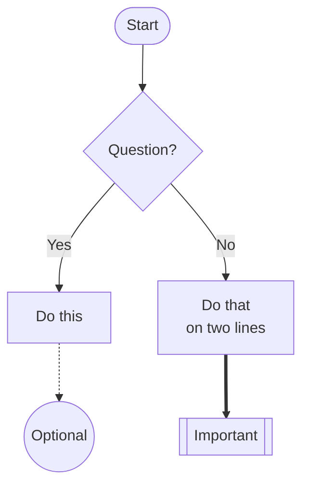

# How to contribute / Como contribuir

Thanks for helping! / Obrigado por ajudar! 🇧🇷 [Português abaixo](#português)

## English

### Quick summary

| I want to... | Do this |
|---|---|
| Share my own trick | Click **Add a tip** in game, or open the [Community tip](../../issues/new?template=tip.yml) issue |
| Fix or complete a page | Click the pencil ✏️ on the file > **Propose changes** |
| Create a new page | Copy a file from [templates/en/](templates/en/) into the right `docs/en/` folder |
| Report a mistake | Open a [Fix](../../issues/new?template=fix.yml) issue |
| Ask for a page in the other language | Open a [Translation](../../issues/new?template=translation.yml) issue |
| Ask a question or share an idea | [Discussions](../../discussions): Q&A or Ideas |

### Where to start

- The **[status board (STATUS.md)](STATUS.md)** shows every page in both languages: ✅ done, 📝 to complete, ❌ missing. It updates by itself.
- Issues labeled [`good first issue`](../../labels/good%20first%20issue) are good for a first contribution. [`help wanted`](../../labels/help%20wanted) ones need more hands.
- Know both languages? Check the [`translation`](../../labels/translation) issues.
- Play a lot? Help with the [`needs in-game check`](../../labels/needs%20in-game%20check) issues.
- When you finish a page, **delete its "Still missing" section** so it shows ✅ on the board.
- Writing something big? Comment on the Issue first so two people don't write the same page.

### Official guide vs tips

- **`docs/` is the official guide**: neutral and checked in game. It explains what things are and how to do them.
- **`tips/` holds community tips**: personal tricks and opinions ("keep reloading your gun and Reloading levels up"). They show in game at the end of the page, under **Community tips**, with your GitHub user name.

If it is a fact that holds for everyone, it goes in the guide. If it is "this is how I do it", it is a tip.

### Tips

- **Easy way**: in game, open the page and click **Add a tip**, or open the **Community tip** issue. A bot puts the tip in the right file and opens the Pull Request. You don't need to know Git.
- **By hand**: see [tips/README.md](tips/README.md).
- Up to 600 characters. No insults, ads, cheats that ruin other people's game, or unmarked spoilers.

### The folder tree is the in-game menu

- Each **folder** is a section. Its `README.md` is the section title and intro. Without a `README.md`, the title comes from the folder name.
- Each **`.md` file** is a page. `docs/<language>/README.md` is the start page.
- The number prefix (`01-`, `02-`) only sets the order and is hidden in game. Unnumbered items go last, in alphabetical order.
- Names use only lowercase letters without accents, numbers and `-`. Example: `04-actions/01-vehicles/01-start-the-car.md`.
- The name without the number (`start-the-car`) is the page **id** and **must be unique within a language**. Tips find their page by it, so you can **move** a page to another folder without losing its tips. If you **rename** it, rename `tips/<language>/<id>.md` too (the script warns you).
- Files and folders starting with `_` are ignored. Use them for drafts.
- **Same numbering in both languages**: `docs/en/02-skills/03-firearms/02-reloading.md` ↔ `docs/pt-BR/02-habilidades/03-armas-de-fogo/02-recarga.md`. The script warns when a page has no pair.

For big structure changes, open a Discussion first.

### Pages for a newer game build

The manual follows the game build. **Build 42 is the base**: `docs/` and `tips/` are the Build 42 manual. When a new build changes something, you do **not** copy the manual: write only the pages that changed, in `builds/<build>/`, at the same path.

- Build 43 changed fishing? Create `builds/43/docs/en/02-skills/06-survival/02-fishing.md` (same path as in `docs/`). It replaces the old page in Build 43 and later.
- Build 44 then uses everything from 42, plus the fishing page of 43, plus whatever `builds/44/` has.
- A new file adds a page. A file whose whole text is `<!-- removed -->` hides the page in that build (on a `README.md`, the whole section).
- Tips go with the page version: tips for the Build 43 fishing page go in `builds/43/tips/en/fishing.md`. The in-game button fills in the build for you (`43/en/fishing`).
- In game, the mod shows the newest manual that is not newer than the game. More details: [builds/README.md](builds/README.md).

### Where each topic goes

| Folder | What goes there |
|---|---|
| `01-the-mod` | Better Experience features |
| `02-skills` | One page per skill, in the categories of the game's skills screen |
| `03-items` | What each item type is, what it is for, where to find it |
| `04-actions` | Step-by-step guides for things players do (driving, building, cooking...) |
| `05-character` | Occupations, traits, moodles, health |
| `06-world` | Map, zombies, power and water, weather, animals |

### Writing rules

- First line: `# Title`. Use the **exact** in-game names, in **bold** (see [GLOSSARY.md](GLOSSARY.md)).
- Short sentences. Explain what the player does, not how the code works.
- Only write what you checked in the game build of the folder (`docs/` is **Build 42**). For numbers that change with sandbox settings, say so.
- Start from the [templates](templates/en/). Suggested sections live in a `<!-- -->` comment that never shows.
- If you can, update the page in the other language. If you can't, say so in the Pull Request.

### Markdown that shows in game

Project Zomboid's text panel is simple. This works:

- `# Title` (one per file), `## Subtitle`, `### Smaller subtitle`
- Paragraphs, `-` lists and numbered `1.` lists
- `**bold**` (yellow), `` `code` `` (blue), `> quote or highlight` (green)
- `[text](link)`: only the text shows in game
- ```` ``` ```` code blocks (blue, line by line) and ```` ```mermaid ```` diagrams (turned into images)
- `<!-- comment -->`: never shows anywhere

**Not** supported in `docs/`: tables (the script rejects them; use a list), loose images and HTML. Avoid the `<` sign in the text. Outside `docs/` (this file, the glossary) anything goes.

### Diagrams (Mermaid)

GitHub renders the diagram, and `tools/build_manual.py` turns the same block into a PNG for the game (dark theme). The game accepts **flowcharts**:

````

````

- Header `flowchart` or `graph`, with direction `TD` (top-down, recommended), `BT`, `LR` or `RL`.
- Shapes: `[rectangle]`, `(rounded)`, `([stadium])`, `{decision}`, `((circle))`, `[[subroutine]]`, `{{hexagon}}`, `[(database)]`.
- Links: `-->`, `---` (no arrow), `-.->` (dotted), `==>` (thick), `<-->` (both ways), with text `-->|text|` or `-- text -->`. Chains (`A --> B --> C`) and groups (`A & B --> C`) work.
- `"quotes"` for labels with symbols; `<br>` for line breaks.
- `classDef`, `style`, `class`, `click`, `linkStyle` and `%%` comments are accepted, but the game ignores colors. `subgraph` shows without its box in game.
- **Game limits**: up to 40 nodes and 1400 px wide. Prefer `TD` and short labels.
- Other diagram types (`sequenceDiagram`, `pie`, `gantt`...) are **rejected** by the script, because the game could not draw them.

To preview the image on your computer:

```
pip install pillow
python tools/mermaid_png.py my-diagram.mmd out.png
python tools/build_manual.py --out /tmp/manual.lua --images /tmp/images
```

### Check before sending (optional)

```
pip install pillow
python tools/build_manual.py --check
```

GitHub runs this same check on every Pull Request. Language and section labels are added automatically.

### Commits and Pull Requests

- One topic per Pull Request, with a short imperative title: `Skills: complete Carpentry`.
- If it solves an Issue, write `Closes #123` in the description.
- Fill in the Pull Request checklist.
- Follow the [Code of Conduct](CODE_OF_CONDUCT.md).

### For maintainers

Triage, review, labels, bots and releases: [MAINTAINING.md](MAINTAINING.md).

---

## Português

### Resumo rápido

| Quero... | Faça |
|---|---|
| Deixar um truque meu | **Adicionar dica** no jogo, ou a Issue [Dica da comunidade](../../issues/new?template=tip.yml) |
| Corrigir ou completar uma página | Lápis ✏️ no arquivo > **Propose changes** |
| Criar uma página nova | Copie um arquivo de [templates/pt-BR/](templates/pt-BR/) para a pasta certa de `docs/pt-BR/` |
| Avisar de um erro | Issue [Correção](../../issues/new?template=fix.yml) |
| Pedir uma página no outro idioma | Issue [Tradução](../../issues/new?template=translation.yml) |
| Perguntar ou dar uma ideia | [Discussions](../../discussions): Q&A ou Ideas |

### Por onde começar

- O **[painel (STATUS.md)](STATUS.md)** mostra cada página nos dois idiomas: ✅ pronta, 📝 para completar, ❌ não existe ainda. Ele se atualiza sozinho.
- Issues com o rótulo [`good first issue`](../../labels/good%20first%20issue) são boas para a primeira vez. As com [`help wanted`](../../labels/help%20wanted) precisam de mais gente.
- Sabe os dois idiomas? Veja as Issues [`translation`](../../labels/translation) (tradução).
- Joga muito? Ajude nas Issues [`needs in-game check`](../../labels/needs%20in-game%20check) (precisa conferir no jogo).
- Quando terminar uma página, **apague a seção "Ainda falta"**. Assim ela fica ✅ no painel.
- Vai escrever algo grande? Comente na Issue antes, para duas pessoas não fazerem a mesma página.

### Guia oficial × dicas

- **`docs/` é o guia oficial**: explica o que cada coisa é e como se faz, de forma neutra e conferida no jogo.
- **`tips/` são as dicas da comunidade**: truques e opiniões pessoais ("fica recarregando a arma sem parar que a Recarga sobe"). Aparecem no jogo no fim da página, em **Dicas da comunidade**, com o seu usuário do GitHub.

Na dúvida: se é fato que vale para todo mundo, vai no guia; se é "eu faço assim", vai nas dicas.

### Dicas

- **Jeito fácil**: no jogo, abra a página e clique em **Adicionar dica**. Ou abra a Issue **Dica da comunidade**. Um robô coloca a dica no arquivo certo e abre o Pull Request. Não precisa saber Git.
- **Na mão**: veja [tips/README.md](tips/README.md).
- Até 600 caracteres. Não são aceitas dicas com ofensa, propaganda, trapaça (exploits que estragam o jogo de outros) ou spoiler sem aviso.

### A árvore de pastas é o menu do jogo

- Cada **pasta** é uma seção. O `README.md` dela é o título e a introdução. Sem `README.md`, o título vem do nome da pasta.
- Cada **arquivo `.md`** é uma página. `docs/<idioma>/README.md` é a página inicial.
- O número no começo do nome (`01-`, `02-`) só define a ordem e não aparece no jogo. Itens sem número vão para o fim, em ordem alfabética.
- Nomes só com letras minúsculas sem acento, números e `-`. Ex.: `04-acoes/01-veiculos/01-ligar-o-carro.md`.
- O nome sem o número (`ligar-o-carro`) é o **id** da página e **não pode se repetir no mesmo idioma**. É por ele que as dicas acham a página: você pode **mover** a página de pasta sem perder as dicas. Se **renomear**, renomeie também `tips/<idioma>/<id>.md` (o script avisa).
- Arquivos e pastas que começam com `_` são ignorados (use para rascunhos).
- **Mesma numeração nos dois idiomas**: `docs/pt-BR/02-habilidades/03-armas-de-fogo/02-recarga.md` ↔ `docs/en/02-skills/03-firearms/02-reloading.md`. O script avisa quando uma página não tem par.

Mudanças grandes de estrutura: abra antes uma Discussion.

### Páginas de uma build nova do jogo

O manual acompanha a build do jogo. **A Build 42 é a base**: `docs/` e `tips/` são o manual da Build 42. Quando uma build nova muda alguma coisa, você **não** copia o manual: escreva só as páginas que mudaram, em `builds/<build>/`, no mesmo caminho.

- A Build 43 mudou a pesca? Crie `builds/43/docs/pt-BR/02-habilidades/06-sobrevivencia/02-pesca.md` (o mesmo caminho de `docs/`). Ela troca a página antiga na Build 43 e nas seguintes.
- A Build 44 então usa tudo da 42, mais a pesca da 43, mais o que tiver em `builds/44/`.
- Um arquivo novo cria uma página. Um arquivo cujo texto é só `<!-- removed -->` esconde a página naquela build (num `README.md`, a seção inteira).
- As dicas vão com a versão da página: dicas da pesca da Build 43 ficam em `builds/43/tips/pt-BR/pesca.md`. O botão do jogo já preenche a build (`43/pt-BR/pesca`).
- No jogo, o mod mostra o manual mais novo que não passa da build do jogo. Mais detalhes: [builds/README.md](builds/README.md).

### Onde colocar cada assunto

| Pasta | O que vai lá |
|---|---|
| `01-o-mod` | Funções do Better Experience |
| `02-habilidades` | Uma página por habilidade, nas categorias da tela de habilidades do jogo |
| `03-itens` | O que é cada tipo de item, para que serve, onde achar |
| `04-acoes` | Passo a passo de coisas que o jogador faz (dirigir, construir, cozinhar...) |
| `05-personagem` | Profissões, traços, estados (moodles), saúde |
| `06-mundo` | Mapa, zumbis, luz e água, clima, animais |

### Regras do texto

- Primeira linha: `# Título`. Use os nomes **exatos** do jogo, em **negrito** (veja o [GLOSSARY.md](GLOSSARY.md)).
- Frases curtas. Explique o que o jogador faz, não como o código funciona.
- Escreva só o que você conferiu na build da pasta (`docs/` é a **Build 42**). Números que mudam com as configurações do mundo (sandbox), diga que dependem delas.
- Comece pelos [modelos](templates/pt-BR/). As seções sugeridas ficam num comentário `<!-- -->` que não aparece em lugar nenhum.
- Se puder, atualize a página no outro idioma. Se não souber, avise no Pull Request.

### Markdown que aparece no jogo

Funciona: `#`, `##`, `###`, parágrafos, listas `-` e `1.`, `**negrito**` (amarelo), `` `código` `` (azul), `> destaque` (verde), `[texto](link)` (só o texto aparece), blocos ```` ``` ```` de código, diagramas ```` ```mermaid ```` e `<!-- comentários -->`.

**Não** funciona em `docs/`: tabelas (o script recusa; use lista), imagens soltas e HTML. Evite o sinal `<` no texto.

### Diagramas (Mermaid)

O GitHub desenha o diagrama; o `tools/build_manual.py` gera a mesma figura em PNG para o jogo (tema escuro). O jogo aceita **fluxogramas** `flowchart`/`graph` (direção `TD` recomendada), com as formas e setas listadas na parte em inglês acima. Limites do jogo: até 40 nós e 1400 px de largura. Outros tipos (`sequenceDiagram`, `pie`, `gantt`...) são recusados.

Para ver a imagem: `python tools/mermaid_png.py meu-diagrama.mmd saida.png` (precisa de `pip install pillow`).

### Testar antes de enviar (opcional)

```
pip install pillow
python tools/build_manual.py --check
```

O GitHub roda essa mesma verificação em todo Pull Request. Os rótulos de idioma e seção entram sozinhos.

### Commits e Pull Requests

- Um assunto por Pull Request. Título curto, no imperativo: `Habilidades: completar Carpintaria`.
- Se resolve uma Issue, escreva `Closes #123` na descrição.
- Preencha o checklist do Pull Request e siga o [Código de Conduta](CODE_OF_CONDUCT.md).

### Para quem cuida do repositório

Triagem, revisão, rótulos, robôs e lançamento de versões: [MAINTAINING.md](MAINTAINING.md#português).
