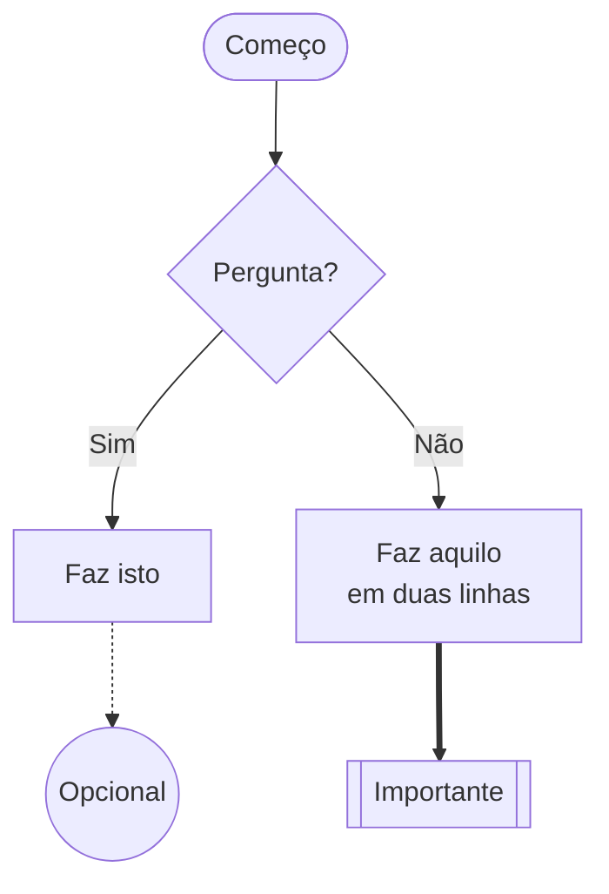

# Como contribuir / How to contribute

Obrigado por ajudar! / Thanks for helping! 🇺🇸 [English below](#english)

## Português

### Resumo rápido

| Quero... | Faça |
|---|---|
| Deixar um truque meu | **Adicionar dica** no jogo, ou a Issue [Dica da comunidade](../../issues/new?template=dica.yml) |
| Corrigir ou completar uma página | Lápis ✏️ no arquivo > **Propose changes** |
| Criar uma página nova | Copie um arquivo de [modelos/pt-BR/](modelos/pt-BR/) para a pasta certa de `docs/pt-BR/` |
| Avisar de um erro ou perguntar | [Issue](../../issues/new/choose) ou [Discussions](../../discussions) |

### Guia oficial × dicas

- **`docs/` é o guia oficial**: explica o que cada coisa é e como se faz, de forma neutra e conferida no jogo.
- **`dicas/` são as dicas da comunidade**: truques e opiniões pessoais ("fica recarregando a arma sem parar que a Recarga sobe"). Aparecem no jogo no fim da página, em **Dicas da comunidade**, com o seu usuário do GitHub.

Na dúvida: se é fato que vale para todo mundo, vai no guia; se é "eu faço assim", vai nas dicas.

### Dicas

- **Jeito fácil**: no jogo, abra a página e clique em **Adicionar dica**. Ou abra a Issue **Dica da comunidade**. Um robô coloca a dica no arquivo certo e abre o Pull Request. Não precisa saber Git.
- **Na mão**: veja [dicas/README.md](dicas/README.md).
- Até 600 caracteres. Não são aceitas dicas com ofensa, propaganda, trapaça (exploits que estragam o jogo de outros) ou spoiler sem aviso.

### A árvore de pastas é o menu do jogo

- Cada **pasta** é uma seção. O `README.md` dela é o título e a introdução. Sem `README.md`, o título vem do nome da pasta.
- Cada **arquivo `.md`** é uma página. `docs/<idioma>/README.md` é a página inicial.
- O número no começo do nome (`01-`, `02-`) só define a ordem e não aparece no jogo. Itens sem número vão para o fim, em ordem alfabética.
- Nomes só com letras minúsculas sem acento, números e `-`. Ex.: `04-acoes/01-veiculos/01-ligar-o-carro.md`.
- O nome sem o número (`ligar-o-carro`) é o **id** da página e **não pode se repetir no mesmo idioma**. É por ele que as dicas acham a página: você pode **mover** a página de pasta sem perder as dicas. Se **renomear**, renomeie também `dicas/<idioma>/<id>.md` (o script avisa).
- Arquivos e pastas que começam com `_` são ignorados (use para rascunhos).
- **Mesma numeração nos dois idiomas**: `docs/pt-BR/02-habilidades/03-armas-de-fogo/02-recarga.md` ↔ `docs/en/02-skills/03-firearms/02-reloading.md`. O script avisa quando uma página não tem par.

Mudanças grandes de estrutura: abra antes uma Discussion.

### Onde colocar cada assunto

| Pasta | O que vai lá |
|---|---|
| `01-o-mod` | Funções do Better Experience |
| `02-habilidades` | Uma página por habilidade, nas categorias da tela de habilidades do jogo |
| `03-itens` | O que é cada tipo de item, para que serve, onde achar |
| `04-acoes` | Passo a passo de coisas que o jogador faz (dirigir, construir, cozinhar...) |
| `05-personagem` | Profissões, traços, estados (moodles), saúde |
| `06-mundo` | Mapa, zumbis, luz e água, clima, animais |

### Regras do texto

- Primeira linha: `# Título`. Use os nomes **exatos** do jogo, em **negrito** (veja o [GLOSSARIO.md](GLOSSARIO.md)).
- Frases curtas. Explique o que o jogador faz, não como o código funciona.
- Escreva só o que você conferiu no **Build 42**. Números que mudam com as configurações do mundo (sandbox), diga que dependem delas.
- Comece pelos [modelos](modelos/pt-BR/). As seções sugeridas ficam num comentário `<!-- -->` que não aparece em lugar nenhum.
- Se puder, atualize a página no outro idioma. Se não souber, avise no Pull Request.

### Markdown que aparece no jogo

O painel de texto do Project Zomboid é simples. Funciona:

- `# Título` (um por arquivo), `## Subtítulo`, `### Subtítulo menor`
- Parágrafos, listas com `-` e numeradas `1.`
- `**negrito**` (amarelo), `` `código` `` (azul), `> citação ou destaque` (verde)
- `[texto](link)`: no jogo aparece só o texto
- Blocos ```` ``` ```` de código (azul, linha por linha) e ```` ```mermaid ```` (viram imagem)
- `<!-- comentário -->`: não aparece em lugar nenhum

**Não** funciona em `docs/`: tabelas (o script recusa; use lista), imagens soltas e HTML. Evite o sinal `<` no texto. Fora de `docs/` (este arquivo, o glossário) pode usar tudo.

### Diagramas (Mermaid)

O GitHub desenha o diagrama; o `tools/build_manual.py` gera a mesma figura em PNG para o jogo (tema escuro). O jogo aceita **fluxogramas**:

````

````

- Cabeçalho `flowchart` ou `graph`, com direção `TD` (de cima para baixo, recomendada), `BT`, `LR` ou `RL`.
- Formas: `[retângulo]`, `(arredondado)`, `([início/fim])`, `{decisão}`, `((círculo))`, `[[sub-rotina]]`, `{{hexágono}}`, `[(banco)]`.
- Setas: `-->`, `---` (sem seta), `-.->` (pontilhada), `==>` (grossa), `<-->` (dupla), com texto `-->|texto|` ou `-- texto -->`. Vale encadear (`A --> B --> C`) e agrupar (`A & B --> C`).
- `"aspas"` para textos com símbolos; `<br>` para quebrar linha.
- `classDef`, `style`, `class`, `click`, `linkStyle` e `%%` comentários são aceitos, mas o jogo ignora as cores. `subgraph` aparece sem a caixa no jogo.
- **Limites do jogo**: até 40 nós e 1400 px de largura. Prefira `TD` e textos curtos.
- Outros tipos (`sequenceDiagram`, `pie`, `gantt`...) são **recusados** pelo script, porque o jogo não saberia desenhar.

Para ver a imagem no seu computador:

```
pip install pillow
python tools/mermaid_png.py meu-diagrama.mmd saida.png
python tools/build_manual.py --out /tmp/manual.lua --images /tmp/imagens
```

### Testar antes de enviar (opcional)

```
pip install pillow
python tools/build_manual.py --check
```

O GitHub roda essa mesma verificação em todo Pull Request.

### Commits e Pull Requests

- Um assunto por Pull Request. Título curto, no imperativo: `Habilidades: completar Carpintaria`.
- Preencha o checklist do Pull Request.
- Siga o [Código de Conduta](CODE_OF_CONDUCT.md).

---

## English

### Quick summary

| I want to... | Do this |
|---|---|
| Leave my own trick | **Add a tip** in game, or the [Community tip](../../issues/new?template=dica.yml) issue |
| Fix or complete a page | Pencil ✏️ on the file > **Propose changes** |
| Create a new page | Copy a file from [modelos/en/](modelos/en/) into the right `docs/en/` folder |
| Report a mistake or ask | [Issue](../../issues/new/choose) or [Discussions](../../discussions) |

### Official guide vs tips

- **`docs/` is the official guide**: neutral, checked in game, explains what things are and how to do them.
- **`dicas/` holds community tips** ("dicas" is Portuguese for tips): personal tricks and opinions. They show in game at the end of the page, under **Community tips**, with your GitHub user name.

If it is a fact that holds for everyone, it goes in the guide; if it is "this is how I do it", it is a tip.

### Tips

- **Easy way**: in game, open the page and click **Add a tip**, or open the **Community tip** issue. A bot puts it in the right file and opens the Pull Request.
- **By hand**: see [dicas/README.md](dicas/README.md).
- Up to 600 characters. No offensive content, ads, cheats that ruin other people's game, or unmarked spoilers.

### The folder tree is the in-game menu

- Each **folder** is a section; its `README.md` is the title and intro. Each **`.md` file** is a page. `docs/<language>/README.md` is the start page.
- The number prefix (`01-`, `02-`) only sets the order and is hidden in game. Unnumbered items go last, alphabetically.
- Names use only lowercase letters without accents, numbers and `-`.
- The name without the number is the page **id** and **must be unique per language**. Tips find their page by it, so you can **move** a page without losing its tips. If you **rename** it, rename `dicas/<language>/<id>.md` too (the script warns you).
- Names starting with `_` are ignored (drafts).
- **Same numbering in both languages**. The script warns when a page has no pair.

For big structure changes, open a Discussion first.

### Where each topic goes

| Folder | What goes there |
|---|---|
| `01-the-mod` | Better Experience features |
| `02-skills` | One page per skill, in the categories of the game's skills screen |
| `03-items` | What each item type is, what it is for, where to find it |
| `04-actions` | Step-by-step things players do (driving, building, cooking...) |
| `05-character` | Occupations, traits, moodles, health |
| `06-world` | Map, zombies, power and water, weather, animals |

### Writing rules

- First line: `# Title`. Use the **exact** in-game names, in **bold** (see [GLOSSARIO.md](GLOSSARIO.md)).
- Short sentences. Explain what the player does, not how the code works.
- Only write what you checked in **Build 42**. For numbers that change with sandbox settings, say so.
- Start from the [templates](modelos/en/). Suggested sections live in a `<!-- -->` comment that never shows.
- If you can, update the page in the other language. If not, say so in the Pull Request.

### Markdown that shows in game

Supported: `#`, `##`, `###` headings, paragraphs, `-` and `1.` lists, `**bold**`, `` `code` ``, `> quote`, `[text](link)` (only the text shows), ```` ``` ```` code blocks, ```` ```mermaid ```` diagrams and `<!-- comments -->`.

**Not** supported in `docs/`: tables (rejected; use a list), loose images and HTML. Avoid `<` in the text.

### Diagrams (Mermaid)

GitHub renders the diagram; `tools/build_manual.py` turns the same block into a PNG for the game (dark theme). The game accepts **flowcharts**:

- Header `flowchart` or `graph`, direction `TD` (recommended), `BT`, `LR` or `RL`.
- Shapes: `[rectangle]`, `(rounded)`, `([stadium])`, `{decision}`, `((circle))`, `[[subroutine]]`, `{{hexagon}}`, `[(database)]`.
- Links: `-->`, `---`, `-.->`, `==>`, `<-->`, with text `-->|text|` or `-- text -->`. Chains (`A --> B --> C`) and groups (`A & B --> C`) work.
- `"quotes"` for labels with symbols; `<br>` for line breaks.
- `classDef`, `style`, `class`, `click`, `linkStyle` and `%%` comments are accepted, but colors are ignored in game. `subgraph` shows without its box in game.
- **Game limits**: up to 40 nodes and 1400 px wide.
- Other diagram types (`sequenceDiagram`, `pie`, `gantt`...) are **rejected**.

Preview: `python tools/mermaid_png.py diagram.mmd out.png` (needs `pip install pillow`).

### Check before sending (optional)

```
pip install pillow
python tools/build_manual.py --check
```

### Commits and Pull Requests

- One topic per Pull Request, short imperative title: `Skills: complete Carpentry`.
- Fill in the Pull Request checklist and follow the [Code of Conduct](CODE_OF_CONDUCT.md).

---

## Para quem cuida do repositório / For maintainers

- **Settings > Actions > General > Workflow permissions**: marque / enable **Allow GitHub Actions to create and approve pull requests** (robô das dicas / tip bot).
- **Settings > General > Features**: ative / enable **Discussions**.
- Rótulo / label `dica` (o formulário usa; o robô também aceita títulos que começam com `[Dica]`).
- Antes de cada versão do mod / Before each mod release:

```
pip install pillow
python tools/build_manual.py
```

Grava `PA_ManualData.lua` e as imagens `media/textures/PA_Manual/d_*.png` na pasta do mod ao lado deste repositório. / Writes `PA_ManualData.lua` and the diagram images into the mod folder next to this repo.
