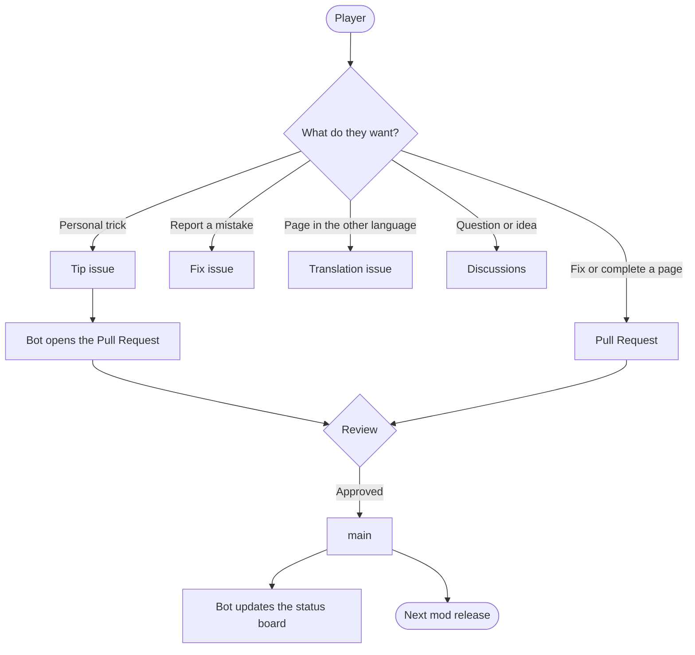

# Maintaining the repository / Manutenção do repositório

For people who review and organize the manual. To write in the manual, see [CONTRIBUTING.md](CONTRIBUTING.md). 🇧🇷 [Português abaixo](#português)

## English

### How contributions arrive

### The bots

| Bot | When it runs | What it does |
|---|---|---|
| **Check manual** (`check.yml`) | Every Pull Request and push to main | Converts the manual to the game format and rejects anything that would break it. Warns when a page has no pair in the other language. |
| **Community tip** (`tip.yml`) | Issue opened with the tip form | Adds the tip to `tips/` and opens a Pull Request. Comments on the Issue if it fails. |
| **Label Pull Request** (`labeler.yml`) | Pull Request opened or updated | Adds language, section, `tip` and `tooling` labels from the changed files ([.github/labeler.yml](.github/labeler.yml)). |
| **Status board** (`status.yml`) | Push to main that changes `docs/` or `tips/` | Rebuilds [STATUS.md](STATUS.md) and commits it to main. |
| **Sync labels** (`labels.yml`) | Change to [.github/labels.yml](.github/labels.yml) | Creates, renames and updates the labels on GitHub. Never deletes. |
| **Welcome** (`welcome.yml`) | Someone's first Issue or Pull Request | Thanks them and points to the status board and CONTRIBUTING. |

### Labels

The official list is [.github/labels.yml](.github/labels.yml). To add or change a label, edit that file and the bot applies it. To rename one, change `name` and keep the old name under `previous`, so existing Issues keep the label.

- **Type**: `tip`, `fix`, `suggestion`, `translation`, `incomplete`, `manual`, `diagram`, `tooling`.
- **Language**: `en`, `pt-BR`.
- **Section**: `section: the mod`, `section: skills`, `section: items`, `section: actions`, `section: character`, `section: world`.
- **Progress**: `good first issue`, `help wanted`, `needs in-game check`, `waiting for reply`, `duplicate`, `wontfix`.

### Triaging Issues

1. Check that the form added a type label. Add the language and the section.
2. Simple, well explained request: add `good first issue`.
3. Something only playing can confirm: add `needs in-game check`.
4. Missing information: ask, and add `waiting for reply`.
5. A question that is not about the manual: **Convert to discussion** (Q&A category).

### Reviewing Pull Requests

- **Is it a fact?** Opinions and "I do it this way" go to `tips/`, not `docs/`.
- **Game names**: the same as the game in each language ([GLOSSARY.md](GLOSSARY.md)).
- **Both languages**: if only one changed, approve anyway and open a `translation` Issue for the other.
- **Moved or renamed page**: the matching `tips/` file must be renamed too. The check fails otherwise.
- **Finished page**: the "Still missing" / "Ainda falta" section should be deleted, so the page shows ✅ on the board.
- **Tips**: up to 600 characters, no insults, ads, cheats or unmarked spoilers. Tips stay signed by their author.
- Prefer **Squash and merge**, with a short title: `Skills: complete Carpentry`.

### Discussions

| Category | What for |
|---|---|
| Announcements | New mod and manual releases. Only maintainers post. |
| Q&A | Questions. Mark the reply that solved it (**Mark as answer**). |
| Ideas | Ideas for the manual or the mod. |
| Show and tell | Organized bases, screenshots, GPS routes. |
| Polls | Votes, such as which section to write next. |
| General | Everything else. |

### Releasing a mod version

1. In the manual folder: `pip install pillow` and `python tools/build_manual.py`. This writes `PA_ManualData.lua` and the diagram images into the mod folder next to this repository.
2. Update the **Versions** page in both languages.
3. Publish the mod and post in **Discussions > Announcements**.

### GitHub settings

These are already on. If the repository is ever copied, turn them on again:

- **Settings > Actions > General > Workflow permissions**: **Allow GitHub Actions to create and approve pull requests** (the tip bot needs it).
- **Settings > General > Features**: **Issues** and **Discussions**.
- **Settings > General > Pull Requests**: **Allow squash merging**, **Always suggest updating pull request branches** and **Automatically delete head branches**.

### Tools

| File | What for |
|---|---|
| `tools/build_manual.py` | Converts the manual for the game (`--check` only validates). |
| `tools/mermaid_png.py` | Draws Mermaid diagrams as images for the game. |
| `tools/add_tip.py` | Used by the tip bot. |
| `tools/status.py` | Builds [STATUS.md](STATUS.md) (`--check` says whether it is out of date). |
| `tools/sync_labels.py` | Used by the label bot (`--dry-run` shows what would change). |

---

## Português

### Os robôs

| Robô | Quando roda | O que faz |
|---|---|---|
| **Check manual** (`check.yml`) | Todo Pull Request e push na main | Converte o manual para o formato do jogo e recusa o que quebraria. Avisa quando uma página não tem par no outro idioma. |
| **Community tip** (`tip.yml`) | Issue com o formulário de dica | Coloca a dica em `tips/` e abre um Pull Request. Se der erro, comenta na Issue. |
| **Label Pull Request** (`labeler.yml`) | Pull Request aberto ou atualizado | Coloca os rótulos de idioma, seção, `tip` e `tooling` pelos arquivos que mudaram. |
| **Status board** (`status.yml`) | Push na main que muda `docs/` ou `tips/` | Refaz o [STATUS.md](STATUS.md) e grava na main. |
| **Sync labels** (`labels.yml`) | Mudança em [.github/labels.yml](.github/labels.yml) | Cria, renomeia e atualiza os rótulos no GitHub. Nunca apaga. |
| **Welcome** (`welcome.yml`) | Primeira Issue ou Pull Request de alguém | Agradece e aponta o painel e o CONTRIBUTING. |

### Rótulos

A lista oficial fica em [.github/labels.yml](.github/labels.yml). Para criar ou mudar um rótulo, edite o arquivo: o robô aplica sozinho. Para renomear, troque o `name` e deixe o nome antigo em `previous`.

- **Tipo**: `tip` (dica), `fix` (correção), `suggestion` (sugestão), `translation` (tradução), `incomplete` (página com "Ainda falta"), `manual`, `diagram`, `tooling` (ferramentas).
- **Idioma**: `en`, `pt-BR`.
- **Seção**: `section: the mod`, `section: skills`, `section: items`, `section: actions`, `section: character`, `section: world`.
- **Andamento**: `good first issue`, `help wanted`, `needs in-game check` (precisa conferir no jogo), `waiting for reply` (aguardando resposta), `duplicate`, `wontfix`.

### Triagem de Issues

1. Confira se o formulário colocou o rótulo de tipo. Acrescente o idioma e a seção.
2. Pedido simples e bem explicado: `good first issue`.
3. Algo que só dá para saber jogando: `needs in-game check`.
4. Falta informação: pergunte e coloque `waiting for reply`.
5. Dúvida que não é sobre o manual: **Convert to discussion** (categoria Q&A).

### Revisão de Pull Requests

- **O texto é fato?** Opinião e "eu faço assim" vão para `tips/`, não para `docs/`.
- **Nomes do jogo**: os mesmos do jogo em cada idioma ([GLOSSARY.md](GLOSSARY.md)).
- **Os dois idiomas**: se só um mudou, aprove do mesmo jeito e abra uma Issue `translation` para o outro.
- **Página movida ou renomeada**: o arquivo de `tips/` precisa mudar junto. A verificação recusa se não mudar.
- **Página completa**: quem terminou deve apagar a seção "Ainda falta" / "Still missing".
- **Dicas**: até 600 caracteres, sem ofensa, propaganda, trapaça ou spoiler sem aviso.
- Prefira **Squash and merge**, com um título curto.

### Discussions

Announcements (versões novas, só quem cuida posta), Q&A (dúvidas; marque a resposta), Ideas (ideias), Show and tell (bases, prints, rotas), Polls (votações) e General (o resto).

### Lançar uma versão do mod

1. Na pasta do manual: `pip install pillow` e `python tools/build_manual.py`. Isso grava `PA_ManualData.lua` e as imagens dos diagramas na pasta do mod ao lado deste repositório.
2. Atualize a página **Versões** nos dois idiomas.
3. Publique o mod e anuncie em **Discussions > Announcements**.

### Configurações do GitHub

Já estão ligadas: **Allow GitHub Actions to create and approve pull requests**, **Issues**, **Discussions**, **Allow squash merging**, **Always suggest updating pull request branches** e **Automatically delete head branches**.
