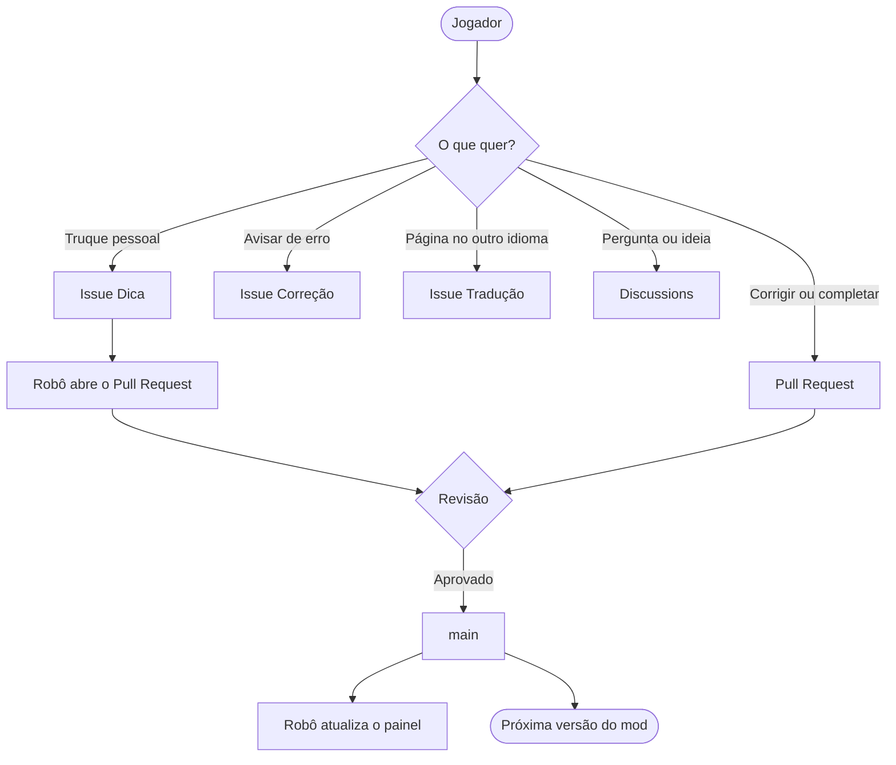

# Manutenção do repositório / Maintaining the repository

Para quem revisa e organiza o manual. Para escrever no manual, veja o [CONTRIBUTING.md](CONTRIBUTING.md). 🇺🇸 [English below](#english)

## Português

### Como as coisas chegam

### Os robôs

| Robô | Quando roda | O que faz |
|---|---|---|
| **Verificar manual** (`check.yml`) | Todo Pull Request e push na main | Converte o manual para o formato do jogo e recusa o que quebraria. Avisa quando uma página não tem par no outro idioma. |
| **Dica da comunidade** (`dica.yml`) | Issue com o formulário de dica | Coloca a dica em `dicas/` e abre um Pull Request. Se der erro, comenta na Issue. |
| **Rotular Pull Request** (`labeler.yml`) | Pull Request aberto ou atualizado | Coloca os rótulos de idioma, seção, `dica` e `ferramentas` pelos arquivos que mudaram ([.github/labeler.yml](.github/labeler.yml)). |
| **Painel do manual** (`status.yml`) | Push na main que muda `docs/` ou `dicas/` | Refaz o [STATUS.md](STATUS.md) e grava na main. |
| **Sincronizar rótulos** (`labels.yml`) | Mudança em [.github/labels.yml](.github/labels.yml) | Cria e atualiza os rótulos no GitHub. Nunca apaga. |
| **Boas-vindas** (`boas-vindas.yml`) | Primeira Issue ou Pull Request de alguém | Agradece e aponta o painel e o CONTRIBUTING. |

### Rótulos

A lista oficial fica em [.github/labels.yml](.github/labels.yml). Para criar ou mudar um rótulo, edite o arquivo: o robô aplica sozinho.

- **Tipo**: `dica`, `correção`, `sugestão`, `tradução`, `completar`, `manual`, `diagrama`, `ferramentas`.
- **Idioma**: `pt-BR`, `en`.
- **Seção**: `seção: o mod`, `seção: habilidades`, `seção: itens`, `seção: ações`, `seção: personagem`, `seção: mundo`.
- **Andamento**: `good first issue` (bom para começar), `help wanted`, `precisa conferir no jogo`, `aguardando resposta`, `duplicate`, `wontfix`.

### Triagem de Issues

1. Confira se o formulário colocou o rótulo de tipo. Acrescente o idioma e a seção.
2. Pedido simples e bem explicado: coloque `good first issue`.
3. Algo que só dá para saber jogando: `precisa conferir no jogo`.
4. Falta informação: pergunte e coloque `aguardando resposta`.
5. Dúvida que não é sobre o manual: converta em Discussion (**Convert to discussion**, categoria Q&A).

### Revisão de Pull Requests

- **O texto é fato?** Opinião e "eu faço assim" vão para `dicas/`, não para `docs/`.
- **Nomes do jogo**: os mesmos do jogo em cada idioma ([GLOSSARIO.md](GLOSSARIO.md)).
- **Os dois idiomas**: se só um mudou, aprove do mesmo jeito e abra uma Issue `tradução` para o outro.
- **Página movida ou renomeada**: o arquivo de `dicas/` com o id antigo precisa mudar junto. A verificação recusa se não mudar.
- **Página completa**: quem terminou deve apagar a seção "Ainda falta" / "Still missing". Assim a página fica ✅ no painel.
- **Dicas**: até 600 caracteres, sem ofensa, propaganda, trapaça ou spoiler sem aviso. A dica fica assinada por quem enviou.
- Prefira **Squash and merge**, com um título curto: `Habilidades: completar Carpintaria`.

### Discussions

| Categoria | Para quê |
|---|---|
| Announcements | Novas versões do mod e do manual. Só quem cuida do repositório posta. |
| Q&A | Dúvidas. Marque a resposta que resolveu (**Mark as answer**). |
| Ideas | Ideias para o manual ou o mod. |
| Show and tell | Bases organizadas, prints, rotas do GPS. |
| Polls | Votações, por exemplo qual seção escrever primeiro. |
| General | O resto. |

### Lançar uma versão do mod

1. Na pasta do manual: `pip install pillow` e `python tools/build_manual.py`. Isso grava `PA_ManualData.lua` e as imagens dos diagramas na pasta do mod ao lado deste repositório.
2. Atualize a página **Versões** nos dois idiomas.
3. Publique o mod e anuncie em **Discussions > Announcements**.

### Configurações do GitHub

Já estão ligadas. Se o repositório for copiado, ligue de novo:

- **Settings > Actions > General > Workflow permissions**: **Allow GitHub Actions to create and approve pull requests** (o robô das dicas precisa).
- **Settings > General > Features**: **Issues** e **Discussions**.
- **Settings > General > Pull Requests**: **Allow squash merging** e **Automatically delete head branches**.

### Ferramentas

| Arquivo | Para quê |
|---|---|
| `tools/build_manual.py` | Converte o manual para o jogo (`--check` só valida). |
| `tools/mermaid_png.py` | Desenha os diagramas Mermaid como imagem para o jogo. |
| `tools/add_tip.py` | Usado pelo robô das dicas. |
| `tools/status.py` | Gera o [STATUS.md](STATUS.md) (`--check` diz se está desatualizado). |
| `tools/sync_labels.py` | Usado pelo robô dos rótulos (`--dry-run` mostra o que mudaria). |

---

## English

### The bots

| Bot | When | What it does |
|---|---|---|
| **Verificar manual** (`check.yml`) | Every Pull Request and push to main | Converts the manual to the game format and rejects anything that would break it. Warns when a page has no pair in the other language. |
| **Dica da comunidade** (`dica.yml`) | Issue opened with the tip form | Adds the tip to `dicas/` and opens a Pull Request. Comments on the Issue if it fails. |
| **Rotular Pull Request** (`labeler.yml`) | Pull Request opened or updated | Adds language, section, `dica` and `ferramentas` labels from the changed files. |
| **Painel do manual** (`status.yml`) | Push to main that changes `docs/` or `dicas/` | Rebuilds [STATUS.md](STATUS.md) and commits it to main. |
| **Sincronizar rótulos** (`labels.yml`) | Change to [.github/labels.yml](.github/labels.yml) | Creates and updates the labels on GitHub. Never deletes. |
| **Boas-vindas** (`boas-vindas.yml`) | Someone's first Issue or Pull Request | Thanks them and points to the status board and CONTRIBUTING. |

### Labels

The official list is [.github/labels.yml](.github/labels.yml). To add or change a label, edit that file and the bot applies it.

### Triage

1. Check that the form added a type label. Add the language and the section.
2. Simple, well explained request: add `good first issue`.
3. Something only playing can confirm: `precisa conferir no jogo` (needs checking in game).
4. Missing information: ask and add `aguardando resposta` (waiting for the author).
5. A question that is not about the manual: **Convert to discussion** (Q&A).

### Reviewing Pull Requests

- **Is it a fact?** Opinions and "I do it this way" go to `dicas/`, not `docs/`.
- **Game names**: the same as the game in each language ([GLOSSARIO.md](GLOSSARIO.md)).
- **Both languages**: if only one changed, approve anyway and open a `tradução` Issue for the other.
- **Moved or renamed page**: the matching `dicas/` file must be renamed too. The check fails otherwise.
- **Finished page**: the "Still missing" / "Ainda falta" section should be removed, so the page shows ✅ on the board.
- **Tips**: up to 600 characters, no insults, ads, cheats or unmarked spoilers. Tips stay signed by their author.
- Prefer **Squash and merge** with a short title.

### Releasing a mod version

1. In the manual folder: `pip install pillow` and `python tools/build_manual.py`. This writes `PA_ManualData.lua` and the diagram images into the mod folder next to this repository.
2. Update the **Versions** page in both languages.
3. Publish the mod and post in **Discussions > Announcements**.

### GitHub settings

Already on. If the repository is ever copied, turn them on again: **Allow GitHub Actions to create and approve pull requests**, **Issues**, **Discussions**, **Allow squash merging** and **Automatically delete head branches**.
