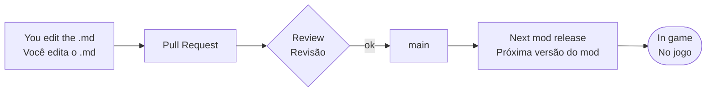

<p align="center"></p>

# Better Experience - ALL In One: Manual

[](../../actions/workflows/check.yml)
[](STATUS.md)
[](../../discussions)

Official manual for the **Better Experience - ALL In One** mod and community guide to **Project Zomboid Build 42**, in English and Brazilian Portuguese. The mod's code is not here: this repository holds the explanations, tutorials and player tips.

The same content shows up **in game**: right-click > Better Experience - ALL In One > **Mod manual**.

> 🇧🇷 Manual oficial do mod e guia comunitário do Project Zomboid Build 42, em inglês e português. O mesmo conteúdo aparece dentro do jogo: clique direito > Better Experience - ALL In One > **Manual do mod**. Cada seção abaixo tem um resumo em português.

- 🇺🇸 [English](docs/en/README.md)
- 🇧🇷 [Português (pt-BR)](docs/pt-BR/README.md)

## What the mod does

| Feature | Em português | Page |
|---|---|---|
| 📦 Base organizer: tag furniture with a category and store everything | Organização da base | [en](docs/en/01-the-mod/01-base-organizer/README.md) · [pt-BR](docs/pt-BR/01-o-mod/01-organizacao-da-base/README.md) |
| 🥫 Food by expiration: what expires first | Comida por validade | [en](docs/en/01-the-mod/02-food-by-expiration.md) · [pt-BR](docs/pt-BR/01-o-mod/02-comida-por-validade.md) |
| 🗺️ Map item search (only what you have seen) | Busca de itens no mapa | [en](docs/en/01-the-mod/03-map-and-gps/01-item-search.md) · [pt-BR](docs/pt-BR/01-o-mod/03-mapa-e-gps/01-busca-de-itens.md) |
| 🛰️ GPS: favorites, navigation and track | GPS | [en](docs/en/01-the-mod/03-map-and-gps/02-gps.md) · [pt-BR](docs/pt-BR/01-o-mod/03-mapa-e-gps/02-gps.md) |
| 🧭 Compass bar with your favorites | Barra de bússola | [en](docs/en/01-the-mod/03-map-and-gps/03-compass.md) · [pt-BR](docs/pt-BR/01-o-mod/03-mapa-e-gps/03-bussola.md) |
| 💧 Drink water stored in bags | Beber da mochila | [en](docs/en/01-the-mod/04-drink-from-bags.md) · [pt-BR](docs/pt-BR/01-o-mod/04-beber-da-mochila.md) |
| ⚙️ Every option and hotkey | Opções | [en](docs/en/01-the-mod/05-options.md) · [pt-BR](docs/pt-BR/01-o-mod/05-opcoes.md) |
| 📖 This manual in game | Este manual | [en](docs/en/01-the-mod/06-this-manual.md) · [pt-BR](docs/pt-BR/01-o-mod/06-este-manual.md) |
| 🆕 What's new in each version | Versões | [en](docs/en/01-the-mod/07-versions.md) · [pt-BR](docs/pt-BR/01-o-mod/07-versoes.md) |
| ❓ FAQ | Perguntas frequentes | [en](docs/en/01-the-mod/08-faq.md) · [pt-BR](docs/pt-BR/01-o-mod/08-perguntas-frequentes.md) |

**Use only what you want:** each feature can be turned off in Options > Mods > Better Experience - ALL In One > Mod features. Whatever is off does not show up, does not run and writes nothing to your save.

> 🇧🇷 **Use só o que quiser:** cada função pode ser desligada em Opções > Mods > Better Experience - ALL In One > Funções do mod. O que estiver desligado não aparece, não roda e não grava nada no save.

## The folder is the menu

What you see here is what players see in game. Each **folder** in `docs/<language>/` becomes a section that opens and closes, and each **file** becomes a page. To reorganize the manual, just move, create or rename folders and files.

```
docs/en/                             docs/pt-BR/
├── README.md       Getting started  ├── README.md       Começando
├── 01-the-mod/     The mod          ├── 01-o-mod/       O mod
├── 02-skills/      Skills           ├── 02-habilidades/ Habilidades
│   ├── 01-physical/                 │   ├── 01-fisico/
│   ├── 02-combat/                   │   ├── 02-combate/
│   ├── 03-firearms/                 │   ├── 03-armas-de-fogo/
│   ├── 04-crafting/                 │   ├── 04-fabricacao/
│   ├── 05-farming-and-animals/      │   ├── 05-agricultura-e-animais/
│   └── 06-survival/                 │   └── 06-sobrevivencia/
├── 03-items/       Items            ├── 03-itens/       Itens
├── 04-actions/     Actions          ├── 04-acoes/       Ações
├── 05-character/   Character        ├── 05-personagem/  Personagem
└── 06-world/       World            └── 06-mundo/       Mundo
```

Skills follow the same categories as the game's skills screen. Both languages share the same numbering, so `02-skills/03-firearms/02-reloading.md` is the pair of `02-habilidades/03-armas-de-fogo/02-recarga.md`.

> 🇧🇷 Cada **pasta** de `docs/<idioma>/` vira uma seção no jogo e cada **arquivo** vira uma página. Os dois idiomas têm a mesma numeração.

## Official guide and community tips

| | Where | What it is |
|---|---|---|
| 📘 Official guide / Guia oficial | `docs/` | Reviewed, neutral text. / Texto revisado e neutro. |
| 💬 Tips / Dicas | `tips/` | Personal, signed tricks shown at the end of the page in game. / Truques pessoais, assinados, no fim da página no jogo. |

Example tip: *"Keep reloading your gun over and over and Reloading levels up fast."* ([tips/en/reloading.md](tips/en/reloading.md))

## Diagrams

[Mermaid](https://mermaid.js.org/) flowcharts work here and in game. GitHub renders the ```` ```mermaid ```` block, and the mod's script turns the same block into an image for the game. See what is supported in [CONTRIBUTING.md](CONTRIBUTING.md#diagrams-mermaid).

> 🇧🇷 Fluxogramas Mermaid funcionam aqui e no jogo.



## Contribute

**Start with the [status board](STATUS.md):** it shows every page in both languages, with ✅ done, 📝 to complete and ❌ missing. Most skills, items, actions, character and world pages are still 📝.

- 💬 **Leave a tip**: in game, click **Add a tip**, or open a ["Community tip" issue](../../issues/new?template=tip.yml). A bot creates the Pull Request.
- ✏️ **Write the guide**: click the pencil on any page. Use the [templates](templates/) and the [glossary](GLOSSARY.md).
- 🌐 **Translate**: see the [`translation`](../../labels/translation) issues, or open a ["Translation" issue](../../issues/new?template=translation.yml).
- 🐞 **Report a mistake**: open a ["Fix" issue](../../issues/new?template=fix.yml).
- 🗨️ **Ask or share ideas**: [Discussions](../../discussions) ([Q&A](../../discussions/categories/q-a), [Ideas](../../discussions/categories/ideas), [Show and tell](../../discussions/categories/show-and-tell)). See also [SUPPORT.md](SUPPORT.md).
- 🏷️ **First time?** Look for [`good first issue`](../../labels/good%20first%20issue).

Read [CONTRIBUTING.md](CONTRIBUTING.md) and the [Code of Conduct](CODE_OF_CONDUCT.md). Each new mod release ships the updated manual and tips in game.

> 🇧🇷 **Comece pelo [painel](STATUS.md)**. Para deixar uma dica, use **Adicionar dica** no jogo. Para escrever, clique no lápis de qualquer página. O [CONTRIBUTING.md](CONTRIBUTING.md#português) tem tudo em português.

## Helper bots

Nobody has to do these by hand.

| | Bot |
|---|---|
| ✔️ | Checks every Pull Request: the manual must still open in game. |
| 💬 | Turns the tip form into a Pull Request. |
| 🏷️ | Labels Pull Requests by language and section. |
| 📊 | Updates the [status board](STATUS.md) on every change. |
| 👋 | Welcomes first-time contributors. |

Details, triage and review: [MAINTAINING.md](MAINTAINING.md).

> 🇧🇷 Robôs conferem os Pull Requests, transformam dicas em Pull Requests, colocam rótulos, atualizam o painel e dão boas-vindas. Detalhes em [MAINTAINING.md](MAINTAINING.md#português).

## Repository layout

```
docs/<language>/      official guide (the in-game tree)
tips/<language>/      community tips, one file per page
templates/<language>/ page templates
tools/                build_manual.py, mermaid_png.py, add_tip.py, status.py, sync_labels.py, fonts
assets/               README images
.github/              forms, bots and labels (labels.yml)
STATUS.md             status board (generated)
CONTRIBUTING.md       how to write
MAINTAINING.md        how to review and organize
SUPPORT.md            where to get help
GLOSSARY.md           official EN ↔ PT in-game terms
manual.config.json    repository, branch and languages
```

## License

Text and images under [CC BY-SA 4.0](LICENSE). DejaVu Sans font in `tools/fonts/` under [its own license](tools/fonts/LICENSE-DejaVu.txt).

Project Zomboid is a trademark of The Indie Stone. This is a fan project with no official affiliation.

> 🇧🇷 Texto e imagens sob CC BY-SA 4.0. Project Zomboid é uma marca da The Indie Stone; este é um projeto de fãs, sem ligação oficial.
