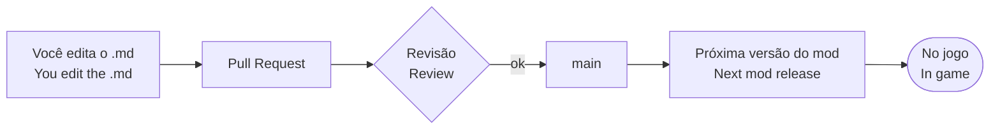

# Better Experience - ALL In One: Manual

[](../../actions/workflows/check.yml)

Manual comunitário do mod **Better Experience - ALL In One** e guia do **Project Zomboid Build 42**, em português e inglês.
Community manual for the **Better Experience - ALL In One** mod and guide to **Project Zomboid Build 42**, in Portuguese and English.

O mesmo conteúdo aparece **dentro do jogo**: clique direito > Better Experience - ALL In One > **Manual do mod**.
The same content shows up **in game**: right-click > Better Experience - ALL In One > **Mod manual**.

- 🇧🇷 [Português (pt-BR)](docs/pt-BR/README.md)
- 🇺🇸 [English](docs/en/README.md)

## A pasta é o menu / The folder is the menu

O que você vê aqui é o que o jogador vê no jogo. Cada **pasta** de `docs/<idioma>/` vira uma seção que abre e fecha, e cada **arquivo** vira uma página. Para reorganizar o manual, basta mover, criar ou renomear pastas e arquivos.

What you see here is what players see in game. Each **folder** in `docs/<language>/` becomes a section that opens and closes, and each **file** becomes a page. To reorganize the manual, just move, create or rename folders and files.

```
docs/pt-BR/                      docs/en/
├── README.md       Começando    ├── README.md       Getting started
├── 01-o-mod/       O mod        ├── 01-the-mod/     The mod
├── 02-habilidades/ Habilidades  ├── 02-skills/      Skills
│   ├── 01-fisico/               │   ├── 01-physical/
│   ├── 02-combate/              │   ├── 02-combat/
│   ├── 03-armas-de-fogo/        │   ├── 03-firearms/
│   ├── 04-fabricacao/           │   ├── 04-crafting/
│   ├── 05-agricultura-e-animais/│   ├── 05-farming-and-animals/
│   └── 06-sobrevivencia/        │   └── 06-survival/
├── 03-itens/       Itens        ├── 03-items/       Items
├── 04-acoes/       Ações        ├── 04-actions/     Actions
├── 05-personagem/  Personagem   ├── 05-character/   Character
└── 06-mundo/       Mundo        └── 06-world/       World
```

As habilidades seguem as mesmas categorias da tela de habilidades do jogo. Os dois idiomas têm a mesma numeração, então `02-habilidades/03-armas-de-fogo/02-recarga.md` é o par de `02-skills/03-firearms/02-reloading.md`.

Skills follow the same categories as the game's skills screen. Both languages share the same numbering, so each page has an obvious pair in the other language.

## Guia oficial e dicas da comunidade / Official guide and community tips

| | Onde / Where | O que é / What it is |
|---|---|---|
| 📘 Guia oficial / Official guide | `docs/` | Texto revisado e neutro. / Reviewed, neutral text. |
| 💬 Dicas / Tips | `dicas/` | Truques pessoais, assinados, que aparecem no fim da página no jogo. / Personal, signed tricks shown at the end of the page in game. |

Exemplo de dica / Example tip: *"Fica recarregando a arma sem parar que a habilidade Recarga sobe."* — [dicas/pt-BR/recarga.md](dicas/pt-BR/recarga.md)

## Diagramas / Diagrams

Fluxogramas em [Mermaid](https://mermaid.js.org/) funcionam aqui e no jogo. O GitHub desenha o bloco ```` ```mermaid ````; o script do mod transforma o mesmo bloco numa imagem para o jogo. Veja o que é aceito no [CONTRIBUTING.md](CONTRIBUTING.md#diagramas-mermaid).

[Mermaid](https://mermaid.js.org/) flowcharts work here and in game. GitHub renders the ```` ```mermaid ```` block; the mod's script turns the same block into an image for the game.



## Ajudar / Contribute

- 💬 **Deixar uma dica / Leave a tip**: no jogo, **Adicionar dica**, ou abra uma [Issue "Dica da comunidade"](../../issues/new?template=dica.yml). Um robô cria o Pull Request. / In game, **Add a tip**, or open a ["Community tip" issue](../../issues/new?template=dica.yml). A bot creates the Pull Request.
- ✏️ **Escrever no guia / Write the guide**: clique no lápis de qualquer página. Use os [modelos](modelos/) e o [glossário](GLOSSARIO.md). / Click the pencil on any page. Use the [templates](modelos/) and the [glossary](GLOSSARIO.md).
- 🗨️ **Sugerir ou perguntar / Suggest or ask**: [Issues](../../issues/new/choose) ou / or [Discussions](../../discussions).

Leia o [CONTRIBUTING.md](CONTRIBUTING.md) e o [Código de Conduta](CODE_OF_CONDUCT.md). Cada nova versão do mod leva o manual e as dicas para dentro do jogo.
Read [CONTRIBUTING.md](CONTRIBUTING.md) and the [Code of Conduct](CODE_OF_CONDUCT.md). Each new mod release ships the updated manual and tips in game.

## Estrutura do repositório / Repository layout

```
docs/<idioma>/        guia oficial (a árvore do jogo) / official guide (the in-game tree)
dicas/<idioma>/       dicas da comunidade, uma por página / community tips, one file per page
modelos/<idioma>/     modelos de página / page templates
tools/                build_manual.py, mermaid_png.py, add_tip.py, fontes / fonts
GLOSSARIO.md          termos oficiais PT ↔ EN / official PT ↔ EN terms
manual.config.json    repositório, branch e idiomas / repo, branch and languages
```

## Licença / License

Texto sob [CC BY-SA 4.0](LICENSE). Fonte DejaVu Sans em `tools/fonts/` sob a [licença própria](tools/fonts/LICENSE-DejaVu.txt).
Text under [CC BY-SA 4.0](LICENSE). DejaVu Sans font in `tools/fonts/` under [its own license](tools/fonts/LICENSE-DejaVu.txt).

Project Zomboid é uma marca da The Indie Stone. Este é um projeto de fãs, sem ligação oficial.
Project Zomboid is a trademark of The Indie Stone. This is a fan project with no official affiliation.
