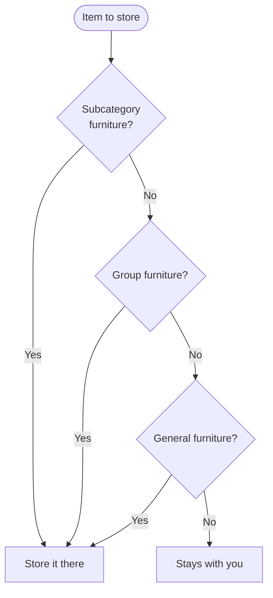

# Where each item goes

An item first looks for furniture with its exact subcategory, then its group and, last, **General**.

Examples:

- Raw meat: **Raw meat** > **All Freezer** > fridge > pantry > **General**.
- Hammer: **General tools** > **All Tools** > materials > **General**.

For food, the sibling subcategories (fridge, pantry) also act as backups before **General**.

## Same items stay together

With several pieces of furniture of the same category, the item goes to the one that already has the most items like it, until it is full. When full, it goes to the next one that takes the category (the nearest). With **Organize the whole base**, identical items spread across furniture of the same category are gathered in the one that already has the most of them.

Example: crate 1 with 10 shovels and 1 bat, crate 2 with 2 shovels and 2 bats, both taking shovels and bats. After organizing: the 12 shovels in crate 1 and the 3 bats in crate 2.
