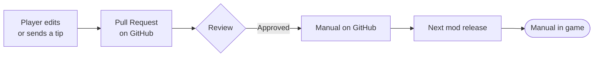

# This manual

Open it with right-click > **Better Experience - ALL In One** > **Mod manual**, or pick a key in **Options > Mods > Better Experience - ALL In One > Hotkeys**.

## The window

- **List on the left**: sections and pages. Click a folder to open or close it.
- **Search**: looks through every page and the community tips, ignoring accents.
- **Text on the right**: the selected page, with diagrams when there are any.

## The buttons

- **Open online**: opens the latest version of the page on GitHub.
- **Edit this page**: opens the GitHub editor to fix or complete the guide.
- **Add a tip**: opens the tip form, already pointing to the right page.
- **Suggest / ask**: opens an Issue about the page.

## Where the content comes from

Everything comes from the manual's public GitHub repository, written by the community. Each new mod release ships the updated manual. Community tips show at the end of the page and can be hidden in **Options > Mods > Better Experience - ALL In One > Manual**.

## One version per game build

The manual follows the game build. **Build 42** is the base. When a new build changes something, the community rewrites only the pages that changed, and the rest stays the same. The mod shows the manual of your build by itself: if your build has no page of its own yet, you see the one from the build before.
