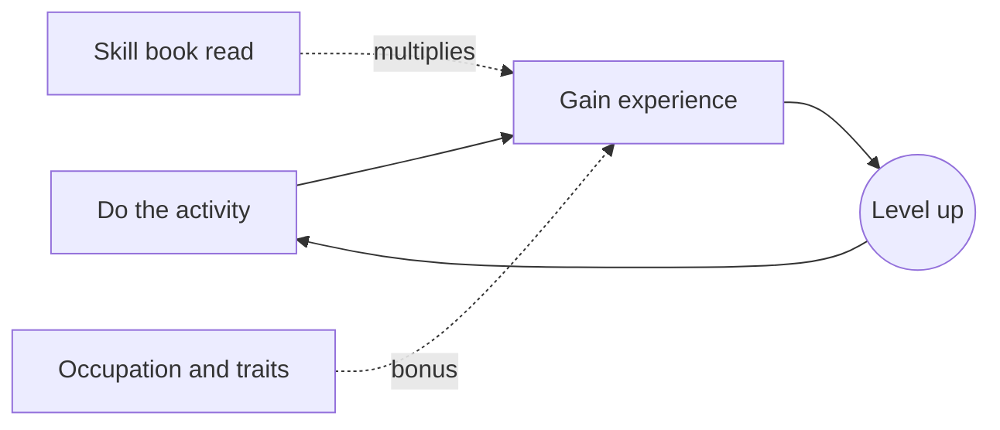

# Skills

Every skill rises by **doing**: reloading a gun trains Reloading, planting and harvesting trains Agriculture. Each goes from level 0 to 10, and high levels need much more experience.

- **Books**: many skills have books for each level range. Reading the right book before training multiplies the experience you gain.
- **Occupation and traits**: start a few levels higher and can give experience bonuses in some skills.
- **Fitness and Strength** are different: they start high and drop if you stay idle or eat poorly.

The folders below follow the same categories as the game's skills screen.
