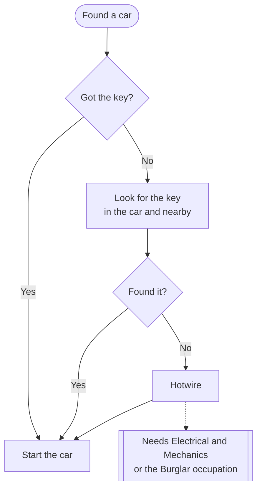

# Start the car

Get in the driver's seat. With the key, the car starts. Without it, look in the car itself, on zombies and in nearby houses.

Before leaving, check the fuel and battery on the dashboard.

## Still missing

This page is just getting started. Use **Edit this page** to fill in the guide, or **Add a tip** to leave your own trick.
