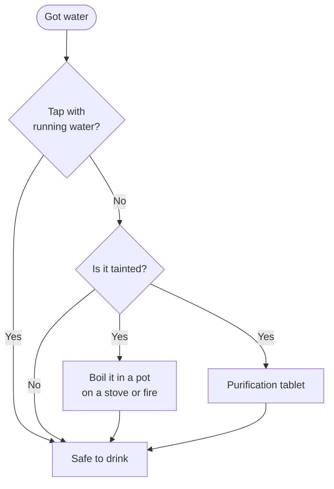

# Safe water

While tap water works, the tap is safe. Once it is shut off, water from rivers, lakes, wells or collected rain can be tainted.

Hover over the container to see if the water is tainted.

## Still missing

This page is just getting started. Use **Edit this page** to fill in the guide, or **Add a tip** to leave your own trick.
