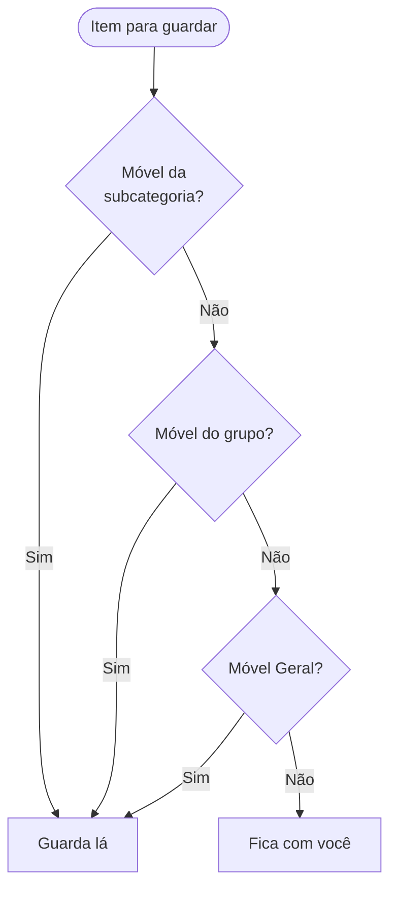

# Para onde cada item vai

O item procura primeiro um móvel da subcategoria exata, depois o grupo dele e, por último, **Geral**.

Exemplos:

- Carne crua: **Carnes cruas** > **Tudo de Congelador** > geladeira > despensa > **Geral**.
- Martelo: **Ferramentas gerais** > **Tudo de Ferramentas** > materiais > **Geral**.

Na comida, as subcategorias vizinhas (geladeira, despensa) também servem de reserva antes do **Geral**.

## Itens iguais ficam juntos

Com vários móveis da mesma categoria, o item vai para o que já tem mais itens iguais a ele, até encher. Cheio, vai para o próximo móvel que aceita a categoria (o mais perto). Em **Organizar a base inteira**, itens iguais espalhados em móveis da mesma categoria são juntados no móvel que já tem mais deles.

Exemplo: caixa 1 com 10 pás e 1 taco, caixa 2 com 2 pás e 2 tacos, as duas aceitando pás e tacos. Depois de organizar: as 12 pás na caixa 1 e os 3 tacos na caixa 2.
