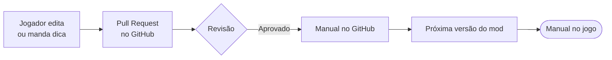

# Este manual

Abra pelo clique direito > **BetterExperience** > **Manual do mod**, ou escolha uma tecla em **Opções > Mods > BetterExperience > Teclas de atalho**.

## A janela

- **Lista à esquerda**: as seções e páginas. Clique numa pasta para abrir ou fechar.
- **Busca**: procura em todas as páginas e nas dicas da comunidade, sem ligar para acentos.
- **Texto à direita**: a página escolhida, com diagramas quando houver.

## Os botões

- **Abrir online**: abre a versão mais nova da página no GitHub.
- **Editar esta página**: abre o editor do GitHub para corrigir ou completar o guia.
- **Adicionar dica**: abre o formulário de dica, já com a página certa.
- **Sugerir / dúvida**: abre uma Issue sobre a página.

## De onde vem o conteúdo

Tudo vem do repositório público do manual no GitHub, escrito pela comunidade. Cada versão nova do mod traz o manual atualizado. As dicas da comunidade aparecem no fim da página e podem ser escondidas em **Opções > Mods > Better Experience - ALL In One > Manual**.

## Uma versão por build do jogo

O manual acompanha a build do jogo. A **Build 42** é a base. Quando uma build nova muda alguma coisa, a comunidade reescreve só as páginas que mudaram, e o resto continua igual. O mod mostra sozinho o manual da sua build: se a sua build ainda não tem página própria, você vê a da build anterior.
