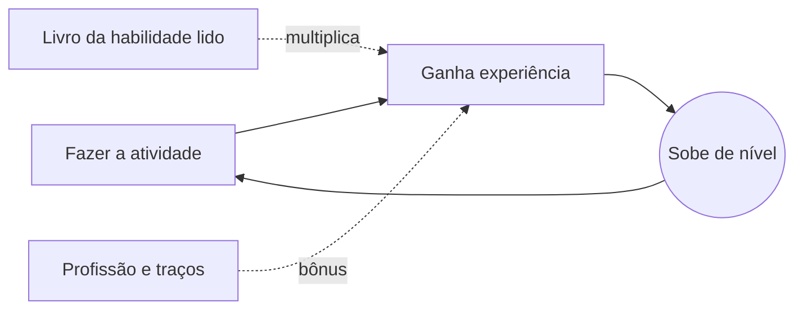

# Habilidades

Toda habilidade sobe **fazendo**: quem recarrega arma treina Recarga, quem planta e colhe treina Agricultura. Cada uma vai do nível 0 ao 10, e os níveis altos pedem muito mais experiência.

- **Livros**: muitas habilidades têm livros por faixa de nível. Ler o livro certo antes de treinar multiplica a experiência ganha.
- **Profissão e traços**: começam alguns níveis acima e podem dar bônus de experiência em certas habilidades.
- **Aptidão Física e Força** são diferentes: começam altas e caem se você ficar parado ou mal alimentado.

As pastas abaixo seguem as mesmas categorias da tela de habilidades do jogo.
