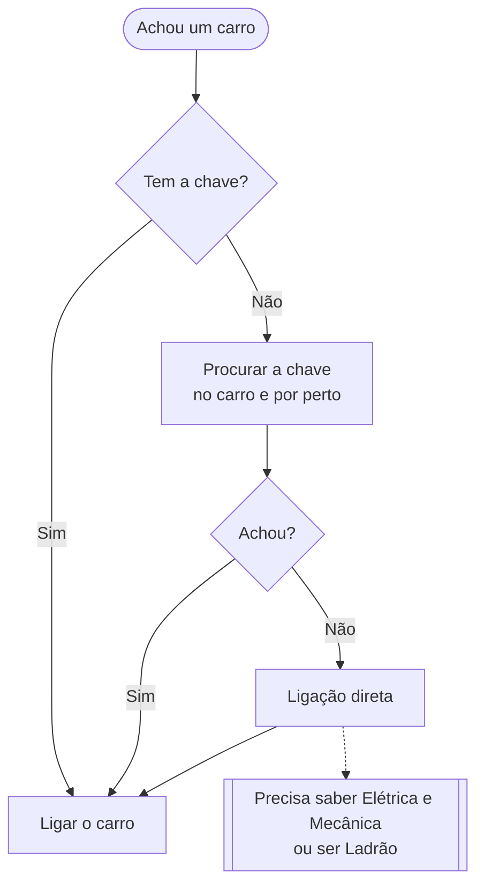

# Ligar o carro

Entre no banco do motorista. Com a chave, o carro liga. Sem a chave, procure no próprio carro, nos zumbis e nas casas perto.

Antes de sair, olhe o combustível e a bateria no painel.

## Ainda falta

Esta página ainda está começando. Use **Editar esta página** para completar o guia, ou **Adicionar dica** para deixar o seu truque.
