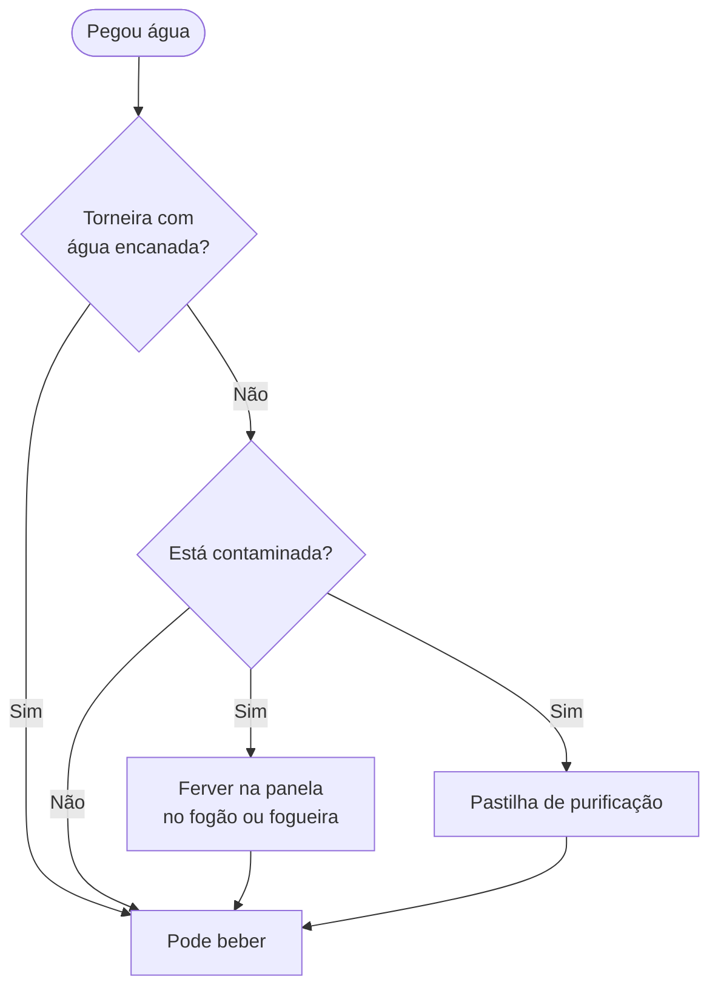

# Água potável

Enquanto a água encanada funciona, a torneira é segura. Depois que ela é cortada, água de rio, lago, poço ou chuva coletada pode estar contaminada.

Passe o mouse sobre o recipiente para ver se a água está contaminada.

## Ainda falta

Esta página ainda está começando. Use **Editar esta página** para completar o guia, ou **Adicionar dica** para deixar o seu truque.
