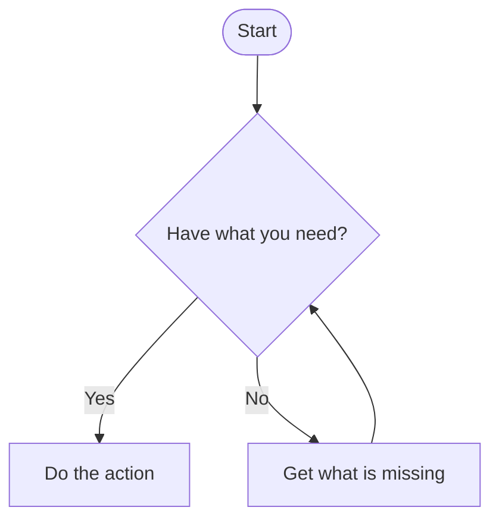

# Action name

<!-- File: 04-actions/... A how-to. A diagram helps when there are choices. -->

What it is and when to do it, in one or two sentences.

## What you need

- Tools, materials, minimum skill.

## Step by step

1. First step.
2. Second step.
3. Third step.

## Common problems

- What can go wrong and how to fix it.
