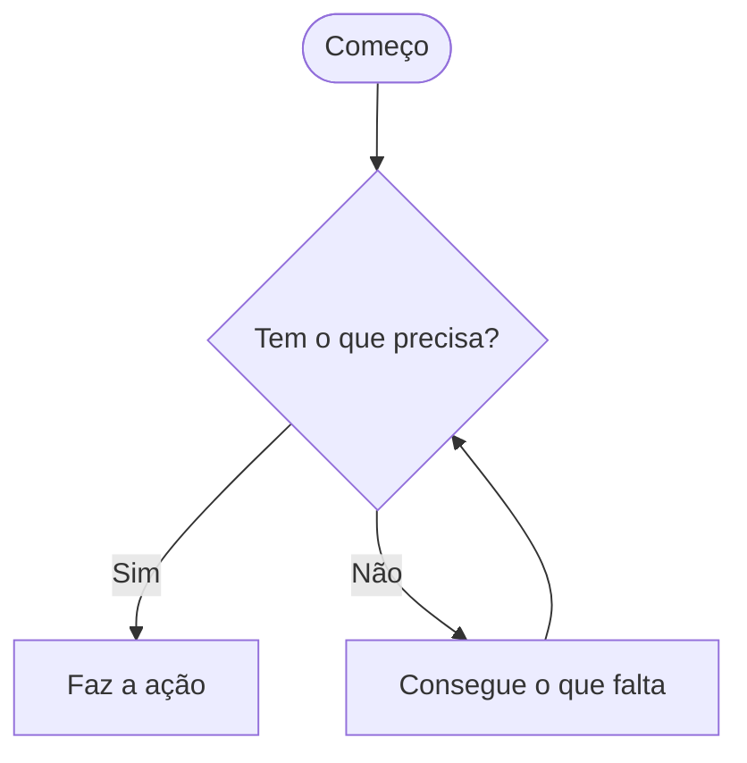

# Nome da ação

<!-- Arquivo: 04-acoes/... Um passo a passo. Um diagrama ajuda quando há escolhas. -->

O que é e quando fazer, em uma ou duas frases.

## Do que precisa

- Ferramentas, materiais, habilidade mínima.

## Passo a passo

1. Primeiro passo.
2. Segundo passo.
3. Terceiro passo.

## Problemas comuns

- O que pode dar errado e como resolver.
